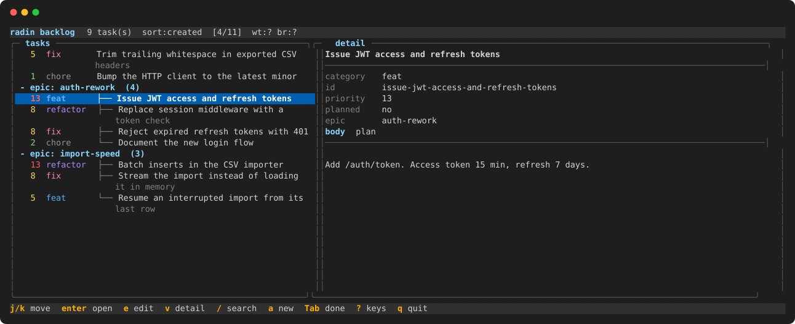

<p align="center">
  <strong>🐀 radin</strong>
</p>

<p align="center">
  <em>A backlog and an implementation loop for Claude Code, built on a stack of token-saving tools.</em>
</p>

<p align="center">
  <sub>"Radin" is French slang for miser. Hence the rat.</sub>
</p>

<p align="center">
  <a href="LICENSE"></a>
  <a href="docs/install.md"></a>
</p>

<p align="center">
  
</p>

radin is a Claude Code plugin for a solo dev on a small subscription. It has two parts.

1. **A backlog that outlives the conversation.** Tasks and epics are files in your repo.
   You record a bug or an idea mid-session and come back to it later.
2. **An agent harness that works the backlog.** A router plans a task, hands it to a fresh
   sub-agent, reviews the diff, and commits. One task, one commit. A run resumes where it stopped.

Both run on a tool stack picked to cut token use without cutting output quality.
radin installs that stack and wires it into the harness.

## Install

```sh
curl -fsSL https://raw.githubusercontent.com/shortcuts/radin/main/install.sh | bash
```

You need `curl`, `tar`, `bash` and the `claude` CLI. Add `-s -- --yes` to accept every default.
Update, repair and uninstall: [docs/install.md](docs/install.md).

## Use it

Record, plan, execute, review. Each skill runs in your own conversation, so it can ask you questions.

| Command | What it does |
| --- | --- |
| `/radin-record` | Turn a bug, idea or aside from this session into a backlog task |
| `/radin-plan` | Write a step-by-step plan for one task. Touches no code |
| `/radin-batch` | Work the backlog in priority order. One task per commit |
| `/radin-do` | Record one ad-hoc prompt as a task, then execute only that task |
| `/radin-review` | Review a commit, PR or directory. Kept findings go to the backlog |
| `/radin-stats` | Show every companion tool's savings report |
| `/radin-uninstall` | Remove what the installer put in `~/.claude` |
| `radin` | Full-screen backlog browser in your terminal. Press `?` for keys |

A task has a category (`feat`, `fix`, `chore`, `refactor`), an optional priority and
dependencies, and can sit under an epic. Every field and key: [docs/reference.md](docs/reference.md).

## The harness

`/radin-batch` and `/radin-do` run the same loop. It follows the orchestrator-workers pattern:
a thin router drives, and sub-agents work.

- **A small router.** It holds ids, titles and exit codes. A worker reads the task, the plan and the code,
  then returns one `STATUS:` line.
- **One worker, one task.** Each worker starts with an empty context and sees only what its task needs.
- **A verify loop.** The worker checks its own diff and retries a failed check three times.
  One review gate at the end of the session reviews every commit and files its findings as new tasks.
- **Just-in-time plans.** radin lints each plan and writes it against the tree as it is now.
- **Model by size.** Only a task rated `low` complexity runs on the cheaper model.
- **State on disk.** Interrupt a run at any point and the next run picks up from there.
- **The CLI does the deterministic work.** Ordering, status and merging are code, not prompts.

Why it works this way: [docs/how-it-works.md](docs/how-it-works.md).
Diagrams: [docs/lifecycle.md](docs/lifecycle.md).

## The tool stack

radin does not rebuild what a good tool already does. It installs each tool below,
configures it, and names it in the loop. It forks none of them.

| Tool | Job in the loop |
| --- | --- |
| [rtk](https://github.com/rtk-ai/rtk) | Wraps dev commands and cuts their output by 60-90% (upstream's figure) |
| [caveman](https://github.com/JuliusBrussee/caveman) | Terse agent prose, about 65% fewer output tokens (upstream's figure) |
| [ponytail](https://github.com/DietrichGebert/ponytail) | Makes the agent write the smallest change that works |
| [codebase-memory-mcp](https://github.com/DeusData/codebase-memory-mcp) | Indexes the repo into a graph, so the agent asks instead of grepping |
| [thermo-nuclear](https://github.com/cursor/plugins/tree/main/cursor-team-kit/skills/thermo-nuclear-code-quality-review) | Strict maintainability review |
| [mattpocock-skills](https://github.com/mattpocock/skills) | Interviewing, research, diagnosis and design skills |
| [unslop](https://github.com/cursor/plugins/tree/main/pstack/skills/unslop) | Strips AI-slop patterns from prose |
| [technical-writing](https://github.com/cursor/plugins/tree/main/pstack/skills/technical-writing) | Writing rules for docs and agent-facing prose |

Run `/radin-stats` to see what each one saved on your machine.
Caveats on unpinned fetches and config repair: [docs/how-it-works.md](docs/how-it-works.md#trade-offs-to-know).

## Documentation

| You want to | Read |
| --- | --- |
| Try radin step by step | [Tutorial](docs/tutorial.md) |
| Install, update or uninstall | [Install guide](docs/install.md) |
| Do one specific thing | [How-to guides](docs/guides.md) |
| Look up a command, field or key | [Reference](docs/reference.md) |
| Understand the design | [How radin works](docs/how-it-works.md), [lifecycle diagrams](docs/lifecycle.md), [decisions](docs/DECISIONS.md) |

## Contribute

[CONTRIBUTING.md](CONTRIBUTING.md) covers tests and measurements.
[AGENTS.md](AGENTS.md) holds the rules for agents that edit this repo.
